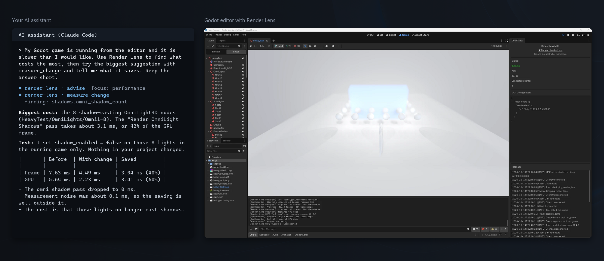

# Render Lens

Rendering and performance measurement for game engines, built for you and your AI assistant. Render Lens runs in the editor as an MCP server: it measures the running game and gives sourced advice on what to fix, and it can try a suggested change in the running game to show what it saves.

| Engine | Folder | Status |
| --- | --- | --- |
| Godot 4.4 to 4.7 | [godot/](godot/README.md) | Available |

More engines are planned.

Free and open source under the [MIT license](LICENSE). If Render Lens saves you time, you can support it on [Ko-fi](https://ko-fi.com/christoskaramoustos) and suggest what to improve; no account is needed.
